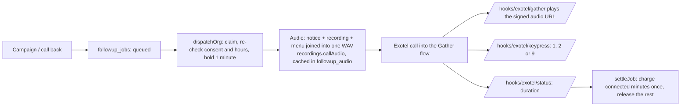

# AI Communication 2.0: architecture

How a gym's calls to its members work after the 2.0 work: two calling modes,
scheduled call backs, conversation records and summaries. The product spec and
operator checklist stay in [FOLLOWUPS.md](FOLLOWUPS.md). The state of the system
before this work is in [AI_COMMUNICATION_AUDIT.md](AI_COMMUNICATION_AUDIT.md).
The call-back engine has its own page, [AI_CALLBACK_ENGINE.md](AI_CALLBACK_ENGINE.md).

## The two calling modes

| | Mode A: prerecorded voice call | Mode B: interactive AI conversation |
|---|---|---|
| Channel in the engine | `call` | `agent` |
| What the member hears | Fixed notice, then the owner's recording (or text read by a TTS voice), then the keypad menu | A real-time AI agent that listens, answers and acts |
| What the member can do | Press 1 (a person), 2 (on it / coming back), 9 (stop) | Talk: ask questions, book a call back, ask for a person, say stop or wrong number |
| Understands speech | No. Keypad only, so nothing a member says is taken as an answer | Yes (provider's speech recognition and language model) |
| Who runs it live | Exotel (Programmable Gather flow) + a speech engine for the notice and menu | ElevenLabs Agents through its Exotel integration, or your own agent server (`providers/http.js`) |
| Test mode | `providers/mock.js` simulates call status and key presses | `simulator.js` plays a member against the real server tools |
| Billed from | `voice:<tier>` minutes | `agent:<tier>` minutes |
| Record kept | `followup_jobs` row | `followup_jobs` row + `followup_conversations` row |

The owner picks the mode on the campaign (three cards: prerecorded, interactive,
messages only), and again for each call back (the AI, a recording, or a person).

### Mode A pipeline



Recordings are uploaded in the browser (`Recordings.jsx`): any format the
browser can decode is converted to 8 kHz mono 16-bit WAV there, previewed, and
uploaded raw. The server (`wav.js`) parses it again, refuses anything it cannot
play (compressed WAV, silence, under 1 second, over 2 minutes) and stores
phone-ready audio in `followup_recordings`. Exotel's Gather step plays one URL,
so the fixed notice and the keypad menu (spoken by the gym's TTS voice) are
joined around the recording into a single cached file.

### Mode B pipeline

```mermaid
sequenceDiagram
  participant E as Engine (dispatch)
  participant P as ElevenLabs Agents / own server
  participant M as Member
  participant T as /hooks/tools/:tool
  participant W as /hooks/elevenlabs (post-call)
  E->>P: upsertAgent (prompt, tools, data collection) if changed
  E->>P: startCall (dynamic variables incl. signed followup_job, today, time_now)
  E->>E: followup_conversations row: in_progress
  P->>M: "Hi Rahul, I'm an AI assistant calling from IRONFORGE FITNESS..."
  M->>P: "Call me next Monday at 6"
  P->>T: schedule_callback {followup_job, when_text, date?, time?}
  T->>T: when.js resolves; callbacks.scheduleCallback books it
  T-->>P: {status: scheduled, when: "Monday 16 November at 6 PM"}
  P->>M: "I'll call you Monday 16 November at 6 PM."
  P->>W: post_call_transcription (transcript, data collection)
  W->>E: applyAgentResult: settle minutes, closeConversation
  E->>E: outcome from tool facts first, summary written by the server
```

The provider's agent does the real-time work: speech recognition, the language
model, turn-taking, interruptions and speech. The server decides everything
that changes state:

| Tool | Does | Answers the agent |
|---|---|---|
| `schedule_callback` | Resolves the member's words with `when.js` (gym timezone, calling hours, open days); books a call back in the same mode | `scheduled` + the exact time to say, or `need_more` + the question to ask |
| `request_person` | Opens a staff call back (high priority, assigned to the member's trainer) and flags an owner action | `recorded` |
| `stop_calls` | Records the opt-out at once (`followup_consent_log`, source `agent`), cancels booked call backs and queued calls | `done` |
| `wrong_number` | Marks the number so it is never called again; cancels booked call backs | `done` |

Every tool request carries two locks: the `X-Barbell-Tool-Key` header (derived
from the server secret, set in the agent's tool definition) and the call's
signed job token in `followup_job`, which the provider fills from a dynamic
variable rather than the model. A tool can therefore only act on that call's gym
and member. Each tool is idempotent: a retried request moves the same booking
or records the same opt-out.

The agent prompt (`studio.agentPrompt`) is fixed in its structure and rules;
the owner supplies the goal, tone, facts, approved answers and switches:

1. The first sentence says it is an AI assistant calling from the gym. A custom
   opening line without "AI" is refused when the agent is saved.
2. Check it is the member before mentioning their membership; otherwise `wrong_number`.
3. Say why it is calling, then listen.
4. Answer only from the owner's facts, the approved answers and, when allowed,
   the gym's own plans (`packages`). Otherwise offer a person.
5. Book call backs only through `schedule_callback`; confirm only after "scheduled".
6. End when the purpose is settled. Never claim a payment, never invent a
   discount, stop at once when asked, finish within the agent's length limit.

Owner switches per agent: tone, longest call (1 to 5 minutes, also the minute
hold), book call backs, hand over to the team, quote plans.

## Conversation records and summaries

`conversations.closeConversation` runs once per AI call (idempotent per job) and
writes:

- **status**: `completed`, `incomplete` (connected but ended before an answer,
  or the AI could not understand), `no_answer`, `busy`, `failed`;
- **outcome** and **intent**: what the tools recorded during the call wins
  (a booked call back, a stop, a wrong number, a request for a person); the
  provider's after-call analysis fills the rest (`renewing`, `will_pay`,
  `coming_back`, `declined`, `question_open`, `not_understood`, `other`);
- renewal interest, questions, objections, call back, escalation, owner action;
- **summary**: one or two sentences generated by `summarize()` from those facts,
  for example "Interested in renewing but could not talk then. Call back booked
  for Monday 16 November at 6 PM." It never says "call completed", names the
  booked date absolutely (a stored "tomorrow" would be wrong a day later), and
  says plainly when nothing was agreed;
- **transcript** (when the gym keeps transcripts), deleted after the gym's
  retention period (30 to 365 days, default 90) by `pruneTranscripts` on every
  tick; switching transcripts off deletes the kept ones at once;
- the tools the agent called and what they answered (`tools_json`), and the
  provider's cost breakdown when it sends one (`cost_json`).

The job keeps a short outcome for campaign planning: a declined member is not
contacted again for that membership; a booked call back pauses campaigns for
that member until it is done.

## Data model (new and changed)

| Table | Change |
|---|---|
| `followup_recordings` | New. The audio library: phone-ready WAV, duration, hash (one row per distinct audio per gym), active or archived. |
| `followup_conversations` | New. One row per AI call, as above. |
| `followup_callbacks` | Extended: `mode` (human/agent/call), `scheduled_for` (UTC), `scheduled_local`, `timezone`, `conversation_id`, `context`, `agent_id`, `recording_id`, `script_group_id`, `language`, `source`, `attempts`, `max_attempts`, `last_job_id`, `last_error`, `events_json`, `completed_at`; statuses `scheduled`, `processing`, `failed`, `expired` added. |
| `followup_jobs` | `callback_id` (the job carries out a call back). |
| `followup_rules` | `recording_id`; `purpose` (service/promotional); kind `announcement`. |
| `followup_agents` | `tone`, `max_minutes`, `allow_callbacks`, `allow_handover`, `answer_plans`. |
| `followup_member_prefs` | `promo_consent`, `promo_opted_out_at`: the separate permission for offers. |
| `followup_settings` | `keep_transcripts`, `transcript_days`. |

All new tables have `org_id`, forced row-level security and the
`tenant_isolation` policy (22 tables in all). Existing databases are upgraded by
`backend/scripts/lib/followupsUpgrade.js` (columns before `schema.sql`, the two
widened CHECK constraints after it). Production has no `followup_*` table yet and
gets everything from the single migration file (see
[AI_COMMUNICATION_DEPLOYMENT.md](AI_COMMUNICATION_DEPLOYMENT.md)).

## Announcements, service and promotional calls

A campaign of kind `announcement` reaches a chosen audience (every member,
active members, memberships ending within N days, recently ended) once, on one
day, never late. It is either **service** (holiday closures, timing changes) or
**promotional** (offers, events). Promotional contact needs the member's own,
separate "Offers and events" permission (`promo_consent`), which only the member
(app switch) or the owner (with evidence) records. A call back the member asked
for never grants it. Turning offers off cancels queued promotional contact at
once. Reminders about a member's own membership are always service calls.

## Isolation and authorisation

- Owner endpoints are behind `requireAuth`, `orgScope` and `requireRole('GYM_OWNER',
  'SUPER_ADMIN')`; every query is scoped by `org_id`; a row from another gym
  returns 404, not 403.
- Members reach only `/api/followups/me`; trainers only call backs assigned to them.
- Postgres row-level security backs every `followup_*` table, including the new ones.
- Provider hooks are authenticated by signatures (ElevenLabs HMAC, your server's
  HMAC), signed job tokens (Exotel), the tool key plus job token (agent tools),
  and `CRON_SECRET` (scheduler).
- Phone numbers are not sent to the owner's screen for automated call backs
  (staff call backs keep them, because a person dials).

## Usage and billing

Unchanged commercial model: prepaid packs per product and tier, a hold when a
call starts, settlement to the connected minutes, a unique ledger row per job
and reason. Call-back attempts are ordinary jobs and are billed the same way.
The founder console's Usage tab (`usageReport.js`, `GET
/api/console/communication/usage`) splits a billing month by calling mode,
campaign and gym, counts call backs (booked, done, failed, missed, cancelled,
for a person) and shows a six-month trend. Money comes only from ledger usage
rows, so a provider retrying a webhook is never counted twice.
